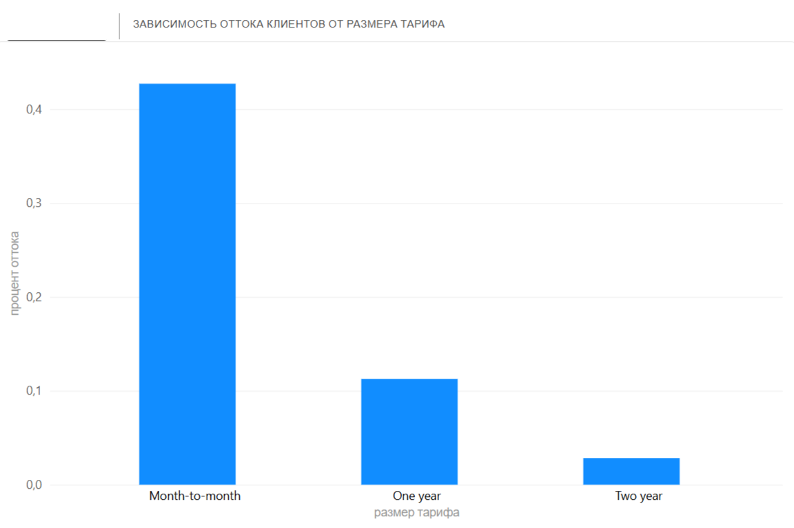

# Анализ оттока клиентов телеком-компании

## Проблема
Компания теряет клиентов. Нужно понять, кто уходит и почему, чтобы предложить стратегию удержания.

## Данные
[Telco Customer Churn](https://www.kaggle.com/datasets/blastchar/telco-customer-churn) — 7 043 клиента, 21 признак.

## Инструменты
Python (Pandas, Seaborn), SQL, Power BI.

## Ключевые инсайты
1. Клиенты на помесячной оплате уходят в 3 раза чаще, чем на годовых контрактах.
2. Средний стаж ушедших клиентов составляет 18 месяцев (против 38 у оставшихся).
3. Клиенты с оптоволокном (Fiber optic) уходят чаще, чем с DSL.

## Рекомендации
- Стимулировать переход на годовые контракты (скидка/бонус).
- Усилить онбординг в первые 6 месяцев.
- Проверить качество услуги Fiber optic.

## Ссылки

  

  
